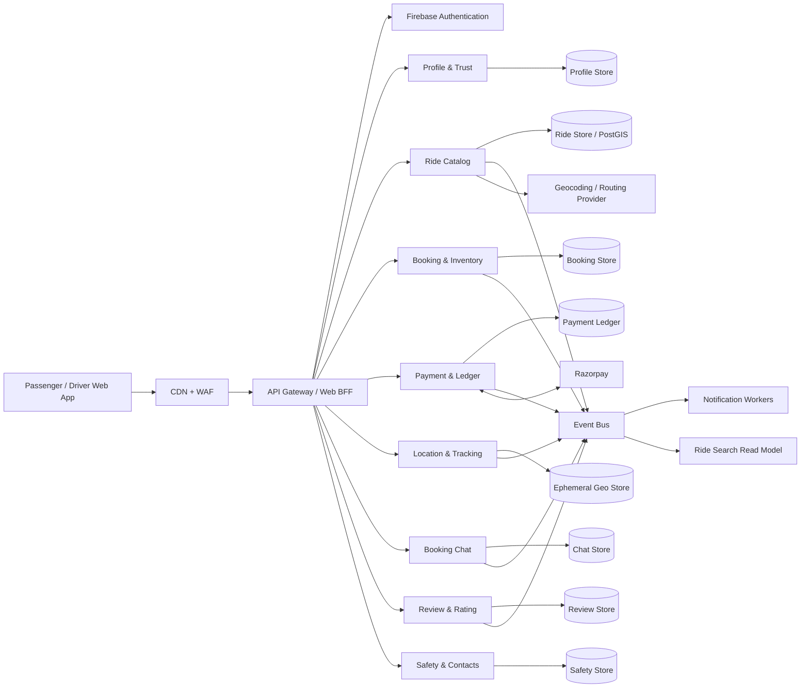

# UberX

UberX is a React/Vite application served by an Express API. Firebase Authentication provides user identity, Firestore stores server-owned application data, and Razorpay Checkout processes ride payments in INR.

For the proposed large-scale service boundaries, data ownership, event flows, deployment model, and phased migration from the current API, see the [Microservices Architecture Guide](docs/microservices/README.md). It is a target design; the current application is not yet deployed as microservices.

## Requirements

- Node.js 20.19+ (or 22.12+)
- A Firebase project with Authentication and Firestore enabled
- A Razorpay account; use test keys during development

## Configure Firebase

In Firebase Console, enable Email/Password, Phone, Email Link, and the OAuth providers used by the app under Authentication > Sign-in method. Add the development and production hostnames under Authentication > Settings > Authorized domains. Phone authentication sends real SMS and may require a billing-enabled Firebase project.

Select the Firebase project used by the Firebase CLI, then create the server environment template:

```sh
npx firebase-tools login
npx firebase-tools use --add
npm run setup:env
```

Choose the same project for the CLI and app configuration. `npm run setup:env` creates `.env` only when it does not already exist; it never overwrites local settings.

Create `.env.local` for the browser configuration:

```dotenv
VITE_FIREBASE_API_KEY=your-firebase-web-api-key
VITE_FIREBASE_AUTH_DOMAIN=your-project.firebaseapp.com
VITE_FIREBASE_PROJECT_ID=your-project-id
VITE_FIREBASE_STORAGE_BUCKET=your-project.appspot.com
VITE_FIREBASE_MESSAGING_SENDER_ID=your-sender-id
VITE_FIREBASE_APP_ID=your-app-id
```

Vite reads these values when the dev server starts or the frontend builds. Restart `npm run dev` after changing `.env.local`. For Vercel, add all six `VITE_FIREBASE_*` variables to the project's Environment Variables for the relevant environments, then redeploy; `.env.local` is not uploaded to Vercel.

Vercel routes `/api/*` requests through `api/[...path].ts` automatically; do not add an `/api` rewrite to `vercel.json`, since that can prevent API handlers from receiving the requested route.

Create `.env` for server-only configuration. Never use a `VITE_` prefix for secrets:

```dotenv
FIREBASE_PROJECT_ID=your-project-id
# Optional. Prefer Application Default Credentials for local development.
# FIREBASE_SERVICE_ACCOUNT_JSON=<full service-account JSON, stored locally only>
RAZORPAY_KEY_ID=rzp_test_your_key_id
RAZORPAY_KEY_SECRET=your_test_key_secret
RAZORPAY_WEBHOOK_SECRET=your_webhook_secret
PORT=3000
APP_URL=https://your-public-app.example.com
TWILIO_ACCOUNT_SID=your_twilio_account_sid
TWILIO_AUTH_TOKEN=your_twilio_auth_token
```

## Configure private Google Drive document storage

Identity images are uploaded by the authenticated server into a private folder in the administrator's Google Drive. Firebase Storage is not used for identity uploads. To connect Drive for local development:

1. In Google Cloud Console, select the same project used for the app, enable the **Google Drive API**, and configure the OAuth consent screen. Add the administrator email as a test user if the app is in Testing mode.
2. Create an OAuth client ID for a **Web application**. Add `http://localhost:3000/api/admin/drive/callback` as an authorized redirect URI.
3. Add these server-only settings to `.env` (never prefix them with `VITE_`):

   ```dotenv
   GOOGLE_DRIVE_CLIENT_ID=your-oauth-client-id
   GOOGLE_DRIVE_CLIENT_SECRET=your-oauth-client-secret
   GOOGLE_DRIVE_REDIRECT_ORIGIN=http://localhost:3000
   WAYSHARE_ADMIN_EMAIL=mandiajayant@gmail.com
   ```

4. Restart `npm run dev`, sign in to WAYSHARE with the administrator account, open **Profile → Admin Management Console**, and choose **Connect admin Google Drive**. Complete Google's consent flow with the same verified admin email.
5. Users can then submit identity images from their profile; authorized reviewers view them inside the admin portal. The app requests `drive.file` access and does not make the Drive folder or images public. The OAuth refresh token is kept in a server-only Firestore integration record; browser clients cannot access it under the restrictive Firestore rules.

Do not paste Google passwords, OAuth client secrets, or tokens into chat or commit them. For a deployed app, configure a public HTTPS callback URL in both the Google OAuth client and `GOOGLE_DRIVE_REDIRECT_ORIGIN`; never use the localhost callback in production. Google Drive quota and account storage limits apply.

Live-location sharing prepares a WhatsApp message for each trusted contact and opens WhatsApp on the user's device; the user reviews and taps **Send**. It uses the WhatsApp account signed in on that device, not a server-side sender, and the signup phone is not automatically verified as a WhatsApp number. Set `APP_URL` to the app's public HTTPS address because localhost links cannot be opened by contacts. Check `/api/health` for `publicAppUrlConfigured` before testing.

For the browser, put the Firebase Web App values in `.env.local`. For the server, use Application Default Credentials or set `GOOGLE_APPLICATION_CREDENTIALS` to a local service-account file. In production, prefer the hosting platform's workload identity/service account and grant only the required Firebase Authentication and Firestore roles. Never commit credentials or paste them into chat. The Firebase web API key is not an Admin credential, but it should still be restricted to your app's domains and APIs.

Deploy the restrictive Firestore rules:

```sh
npx firebase-tools deploy --only firestore:rules --project your-project-id
```

The API uses the Firebase Admin SDK, which bypasses Firestore client rules. Browser clients cannot directly create rides, alter seat counts, mark bookings paid, or approve verification.

## Configure Razorpay

Use Razorpay test keys first. In the Razorpay dashboard, register this webhook URL:

```text
https://YOUR_API_HOST/api/webhooks/razorpay
```

Subscribe to `payment.captured` and `payment.failed`, then copy the webhook signing secret to `RAZORPAY_WEBHOOK_SECRET`. The checkout flow asks the server to create an order from the stored ride price, reserves seats in a Firestore transaction, verifies the returned signature and provider amount, and only then confirms the booking. Failed/closed checkouts release their seats. Cancellation requests a refund from Razorpay and records its pending/complete state.

## Run and verify

```sh
npm install
npm run dev
```

Open `http://localhost:3000`. Check `http://localhost:3000/api/health` for service and provider configuration status. Useful checks:

```sh
npm run lint
npm run build
```

For production, set the same environment variables in the hosting platform, build with `npm run build`, and start with `npm start`. Terminate TLS at the hosting platform/load balancer and configure the Razorpay webhook against the public HTTPS URL.

## Backend API

All `/api` routes except health and the Razorpay webhook require `Authorization: Bearer <Firebase ID token>`.

- `POST /api/user/session`, `GET /api/user`, `PUT /api/user`
- `GET /api/rides`, `GET /api/rides/:id`, `POST /api/rides`
- `GET /api/driver/rides`, `PATCH /api/rides/:id/status`
- `POST /api/payments/orders`, `POST /api/payments/verify`
- `POST /api/payments/reservations/:bookingId/cancel`
- `GET /api/bookings`, `PATCH /api/bookings/:id/cancel`
- `GET /api/scheduled-rides`, `POST /api/scheduled-rides` (request only; assignment/payment are separate)
- `POST /api/user/verify-document` creates a pending verification request; it does not verify a document
- `POST /api/webhooks/razorpay` verifies provider webhooks

The project data model is defined in [firestore.schema.json](firestore.schema.json) and published to `appMetadata/firestoreSchemaV1` in the configured project. It lists 15 collection definitions, separating active API-backed collections from planned app modules. Firestore does not pre-create empty tables: collections appear when their first document is written. Empty project collections were initialized with a `schema_placeholder_v1` document marked `schemaOnly: true` and `safeToDelete: true`; these are not live users, rides, bookings, payments, or operational records. Remove only that placeholder document from the Console after real records exist. Active records use `users`, `rides`, `bookings`, `payments`, `verificationRequests`, and `scheduledRides`; booking reservations and seat updates use Firestore transactions.

## Production work still required

- Connect a compliant KYC/document-upload and human-review provider. The current verification endpoint records a pending request only; it deliberately cannot approve drivers or store identity numbers.
- Implement marketplace driver onboarding, commissions, payout/settlement, and refund/cancellation policy before charging real customers. Current Razorpay integration collects and refunds passenger payments; it does not pay drivers.
- Configure production Firebase providers/domains, Razorpay live credentials and webhook, secret storage, backups, monitoring, rate limiting, abuse controls, and operational support.
- Safety dispatch, SMS notifications, support-ticket workflows, chat, and admin review screens still need their own production service integrations; they are not represented as successfully delivered by this payment/ride API.

## Proposed Microservices Flow

This is the target architecture, not the current deployment. See the [Microservices Architecture Guide](docs/microservices/README.md) for service responsibilities, data ownership, event contracts, security, and migration phases.

