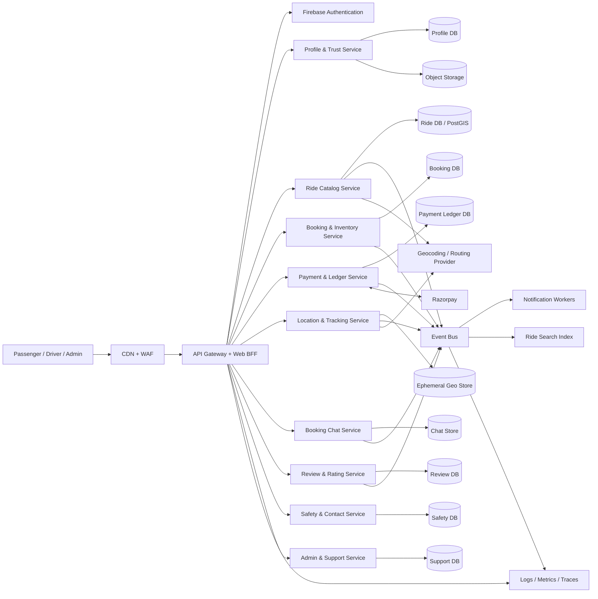
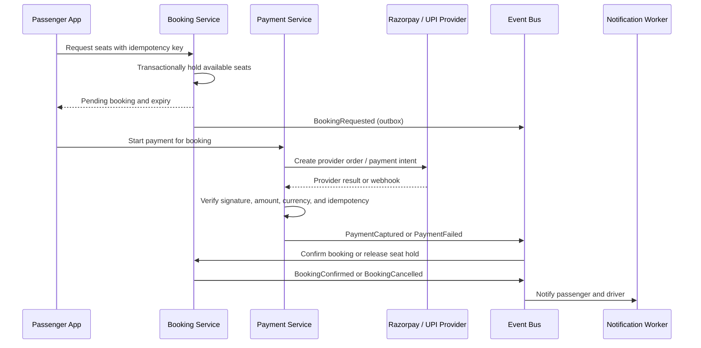

# WAYSHARE Microservices Architecture

**Status:** Target architecture and migration guide. This document describes a future architecture; the repository currently runs as a React/Vite client with one Express API and Firebase/Firestore, not as deployed microservices.

## Current Baseline

- `server.ts` serves the Vite application and mounts the Express API.
- `backend/api.ts` owns most API domains in one process: profiles, ride listings, booking and seat reservation, Razorpay integration, reviews, location sharing, trusted contacts, and booking chat.
- Firebase Authentication identifies users. Firebase Admin verifies ID tokens. Firestore is the server-owned persistence layer.
- The browser uses a shared `src/services/store.ts` to call the API.
- Razorpay is the payment provider. City geocoding and routing currently use Nominatim and OSRM public endpoints; the maps render OpenStreetMap tiles.
- `vercel.json` rewrites API paths to a catch-all serverless entry point. This is a deployment configuration, not a microservice decomposition.

The target below preserves the current user experience and API contracts during migration while introducing independent ownership, scaling, and failure boundaries.

## Goals and Boundaries

1. Keep authentication centralized on Firebase Authentication initially; do not build a second identity system.
2. Give each service clear ownership of its data and business rules. Services do not read or write another service's database directly.
3. Use synchronous APIs for user-facing queries and commands that need an immediate response. Use events for cross-service work that can complete asynchronously.
4. Keep seat allocation and payment state transitions transactional and idempotent.
5. Extract services incrementally from the current API. Do not split the codebase or database in one release.

## Target Architecture



### Request Path

1. The web app calls a versioned API through the gateway/BFF.
2. The gateway validates the Firebase ID token, applies request-size limits, rate limits, and routing, then forwards the authenticated subject and trace context.
3. The owning service authorizes the operation against its own records. The gateway is not the only authorization layer.
4. The service commits its own transaction and an outbox event. An outbox publisher sends committed events to the event bus.
5. Consumers update read models or perform work such as notifications. Consumers are idempotent and can replay events.

### Proposed Services

| Service | Owns and is responsible for | Existing code to migrate |
|---|---|---|
| API Gateway and Web BFF | Public API versions, Firebase token validation, routing, quotas, response aggregation, correlation IDs. No business database. | `backend/app.ts`, cross-cutting middleware in `backend/api.ts` |
| Profile and Trust | Passenger/driver profile, role and verification state, vehicle documents metadata, trusted contacts, upload authorization. Human verification decisions remain auditable. | `/api/user*`, `/api/user/verify-document`, `/api/trusted-contacts*` |
| Ride Catalog | Ride publication, driver ownership, route and schedule metadata, availability projections, ride search. Owns canonical ride records. | `/api/rides`, `/api/driver/rides`, ride status transitions |
| Booking and Inventory | Booking lifecycle, seat holds, expiration, cancellation state, passenger/driver booking views. Owns seat allocation and booking references. | `/api/bookings*`, cash/UPI booking commands, seat reservation parts of payment order creation |
| Payment and Ledger | Provider orders, payment attempts, immutable financial entries, webhook verification, refunds, driver payout integration. | `/api/payments*`, Razorpay webhook handling, payment confirmation rules |
| Location and Tracking | Driver GPS ingestion, ride-scoped access checks, freshness/retention, passenger live-location subscription. | `/api/rides/:id/location`, `/api/location-sharing*` |
| Booking Chat | Booking-scoped conversations, message persistence, participant authorization, delivery/read state. | `/api/bookings/:id/messages` |
| Review and Rating | Review eligibility, one-review policy, moderation, driver rating aggregates. | `/api/reviews*` and rating updates |
| Safety and Contacts | Trusted-contact workflows, safety incidents, emergency escalation integrations. | Safety-related profile data and location-sharing workflows |
| Notification Workers | Push/SMS/email/WhatsApp provider adapters, templates, retries, user preferences. | Current UI notifications and provider integrations as they are implemented |
| Admin and Support | Human review queues, audit trails, support tickets, administrative actions and role checks. | Admin/support UI workflows; production service integration is still future work |

Start with a small number of deployables. For example, keep Profile and Trust with Admin operations initially, and keep Reviews with Ride Catalog until independent scaling or ownership justifies an extraction.

## Data Ownership

| Data | Authoritative owner | Large-scale storage direction |
|---|---|---|
| User profile and verification metadata | Profile and Trust | PostgreSQL or Firestore owned by this service; identity credentials remain in Firebase Auth |
| Rides, schedules, route metadata | Ride Catalog | PostgreSQL with PostGIS for spatial queries; a search index is a derived read model |
| Seat inventory and bookings | Booking and Inventory | PostgreSQL transactions and uniqueness/locking rules; Redis may cache availability but is never authoritative |
| Payment attempts and ledger entries | Payment and Ledger | Isolated PostgreSQL database with append-only financial entries and restricted access |
| Driver live coordinates | Location and Tracking | Redis Geo / managed low-latency geo store with TTL; publish updates through a stream/event channel |
| Shared safety locations | Safety and Contacts | Separate purpose-limited store with strict expiry and access audit |
| Chat messages | Booking Chat | Partitioned message store keyed by booking/conversation; enforce retention and deletion policy |
| QR uploads and driver documents | Profile and Trust / Payment | Object storage such as Google Cloud Storage; persist object IDs and metadata, not base64 image data in ride documents |
| Reviews | Review and Rating | PostgreSQL; aggregate ratings are derived and can be rebuilt from approved reviews |

A service owns its schema even if early deployments use separate databases/schemas on one managed database cluster. Other services consume APIs or events, never cross-service SQL/Firestore queries. Migrate the current shared Firestore collections by ownership and record IDs, not by copying the entire database into every service.

## Events and Workflows

Use a managed event bus such as Google Cloud Pub/Sub. Define versioned event envelopes with `eventId`, `eventType`, `schemaVersion`, `occurredAt`, `producer`, `traceId`, and the minimum required payload. Avoid putting phone numbers, payment credentials, or raw GPS history on broadly consumed topics.

Recommended domain events include:

- `RidePublished`, `RideUpdated`, `RideStatusChanged`
- `BookingRequested`, `SeatHoldCreated`, `BookingConfirmed`, `BookingCancelled`, `SeatHoldExpired`
- `PaymentOrderCreated`, `PaymentCaptured`, `PaymentFailed`, `RefundRequested`, `RefundCompleted`
- `DriverLocationUpdated` (short-lived stream; do not retain a permanent GPS trail by default)
- `ReviewSubmitted`, `ReviewModerated`
- `NotificationRequested`

### Booking and Payment Saga



Cash and driver-QR UPI need explicit states. Cash is due at pickup and is not provider-settled. A passenger scanning a QR is not proof of payment; a driver acknowledgement is a reported collection, not an independently verified settlement. Keep these states distinct from provider-confirmed `PAID`. For automated confirmation, use a payment provider's verified callback/reference and reconcile it against the booking amount and currency.

Never rely on a distributed transaction across Booking and Payment. Booking owns a time-limited seat hold; Payment emits an idempotent outcome; Booking finalizes or releases the hold. Use a transactional outbox/inbox and a reconciliation job for stuck states.

### Live Tracking

The driver app requests device GPS permission only for an active ride and sends throttled coordinate updates to Location and Tracking. The service authenticates the driver against the ride, stores only the latest coordinate with a short TTL, and publishes to the ride's authorized passenger channel. Passengers must have a non-cancelled booking. Use SSE or WebSockets through a horizontally scalable gateway with Redis Pub/Sub or a managed streaming service behind it. Revoke subscriptions when a booking or ride is cancelled/completed, and expire stale coordinates automatically.

## Deployment and Scale Plan

A GCP deployment aligned with the existing Firebase project is a reasonable target:

- Cloud CDN and Cloud Armor in front of a regional HTTPS load balancer and API Gateway.
- Separate stateless Cloud Run services for the gateway/BFF and each independently extracted domain service. Autoscale on CPU, concurrency, queue depth, and latency; set maximum instances and budgets to control runaway spend.
- Cloud SQL for PostgreSQL, initially with separate databases/schemas and service identities; use PostGIS for ride geospatial search. Add read replicas only for measured read pressure.
- Pub/Sub for domain events and Cloud Tasks for delayed/retried commands such as hold expiry and notifications.
- Memorystore/Redis for ephemeral location, presence, rate limits, and cache. Never use cache as the source of truth for bookings or financial records.
- Cloud Storage for QR, vehicle, and identity documents with private buckets, scoped signed URLs, malware scanning, encryption, retention, and audited access.
- Secret Manager and workload identity for secrets and service-to-service credentials. No production service-account JSON in source control or browser variables.
- Cloud Logging/Monitoring/Trace and Error Reporting, with OpenTelemetry context propagated across HTTP and events.

A cloud-neutral equivalent is possible, but choose one deployment and data platform per environment. The current Vercel catch-all is suitable for the existing application shape; it does not by itself provide independent service deployment, event processing, or per-domain scaling.

### Scale and Reliability Controls

- Partition high-volume data by stable ownership keys: `rideId` for location and booking-related streams, `bookingId` for chat and payment events, and `userId` for profile views. Avoid a single global hot partition.
- Keep GPS updates ephemeral, throttle client updates, reject invalid/out-of-area coordinates, and avoid logging coordinate payloads. Apply TTL and least-privilege access.
- Add idempotency keys to booking, payment, refund, and webhook commands. Persist provider event IDs to prevent duplicate processing.
- Apply per-user, per-IP, and per-ride rate limits; cap payload sizes; validate every external provider callback; use circuit breakers and bounded retries with jitter.
- Cache ride-search read models and static route results. Do not let a cache bypass booking authorization or seat checks.
- Use backpressure and dead-letter topics. Alert on queue age, failed event rate, booking holds not finalized, payment/booking mismatches, stale driver coordinates, and provider webhook lag.
- Define and test regional recovery, point-in-time database recovery, backup restoration, and event replay. Do not claim multi-region active-active correctness until booking and ledger conflict behavior is designed and tested.

### Maps and Route Providers

The app currently uses public Nominatim and OSRM endpoints and OpenStreetMap tiles. Public demo endpoints are useful for development, not a large-scale production SLA. Before launch at scale, review each provider's usage policy and attribution requirements, cache geocoding/route results, add timeouts and fallback UX, and select a contracted map/routing provider or operate a properly sized self-hosted stack. Keep API keys and provider calls behind a server-side adapter when the provider requires credentials.

## Security and Privacy

- Firebase ID tokens establish the end-user identity. Each service still checks whether that identity owns the resource or is an authorized participant.
- Use separate workload identities and database roles per service; mTLS or platform identity for internal service calls; never trust client-supplied `driverId`, amount, payment status, seat count, or role.
- Keep payment provider secrets in Secret Manager. Store provider IDs and financial state, not card PAN/CVV. Scope PCI responsibilities with the payment provider.
- Encrypt data in transit and at rest. Audit access to identity documents, payment transitions, administrative overrides, and location-sharing links.
- Set retention and deletion policies for GPS, chat, verification documents, and payment records. Apply the minimum retention required by safety, legal, and financial obligations.
- Protect public endpoints with WAF rules, body limits, schema validation, abuse detection, and safe error responses. Redact tokens, secrets, private messages, and precise coordinates from logs.

## Repository Evolution

A possible target layout after the first extraction is:

```text
apps/
  web/
services/
  api-gateway/
  ride-catalog/
  booking-inventory/
  payment-ledger/
  location-tracking/
  booking-chat/
  profile-trust/
  review-rating/
  notification-worker/
packages/
  api-contracts/
  event-schemas/
  observability/
infrastructure/
  terraform/
```

Do not create these directories until a service is actually extracted. While the API remains a monolith, organize modules by domain and publish stable internal interfaces so later extraction does not require a rewrite.

## Migration Plan

1. **Baseline and boundaries:** Inventory routes and Firestore writes; define service owners, API contracts, event schemas, authorization tests, and current behavior tests. Add request IDs and structured logs.
2. **Modularize the API:** Move `backend/api.ts` handlers into domain modules while retaining one Express process and one deployment. Remove cross-domain data mutations behind explicit service interfaces.
3. **Harden transactions:** Make booking/payment commands idempotent, add seat-hold expiry, payment reconciliation, and transactional outbox records. Document QR/cash state semantics before moving payment logic.
4. **Extract low-coupling services:** Extract notifications and location/tracking first. Introduce the event bus, a gateway route, service identities, TTL storage, and participant authorization. Keep rollback routing to the monolith during canary.
5. **Extract chat, reviews, and ride catalog:** Migrate with change-data capture or controlled backfill, compare reads, then shift a small percentage of traffic. Keep rollback and reconciliation procedures.
6. **Extract booking and payment last:** Move seat inventory and the financial ledger only after concurrency, webhook, refund, reconciliation, and failure-injection tests pass. Avoid dual-writes without an outbox and deterministic repair plan.
7. **Scale and retire:** Load-test each service, tune autoscaling and data partitions, validate disaster recovery, then remove old monolith routes only after traffic and data parity are proven.

Each phase needs an owner, SLOs, dashboard/alerts, migration and rollback steps, and a production readiness review. Extract a service only when independent scaling, security, deployment cadence, or ownership outweighs the network and operational complexity.

## Operational Readiness Checklist

- [ ] Service API and event schemas are versioned and compatibility-tested.
- [ ] Every command is authorized at the owning service and has an idempotency strategy.
- [ ] Booking hold expiry, payment reconciliation, and event replay are tested.
- [ ] Database ownership and migration/rollback procedures are documented.
- [ ] Load, soak, failure-injection, and restore tests meet agreed SLOs.
- [ ] Dashboards and alerts cover user latency, provider failures, queues, financial mismatch, and stale GPS.
- [ ] Secrets, backups, audit policies, data retention, and incident runbooks are approved.
- [ ] Map provider licensing, rate limits, attribution, and production SLA are settled.
